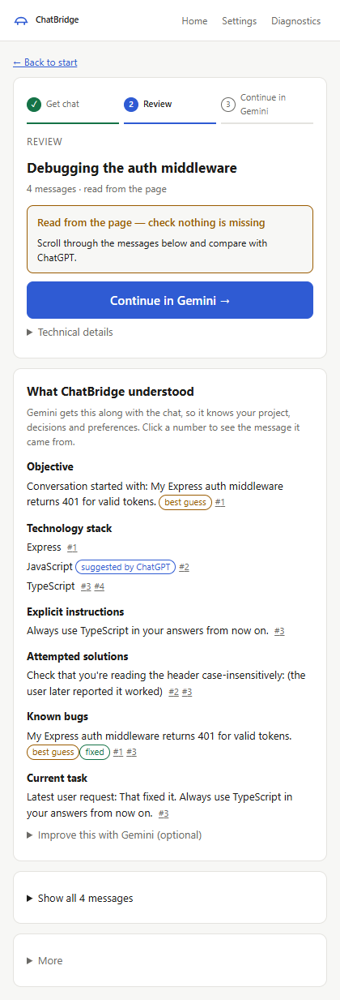
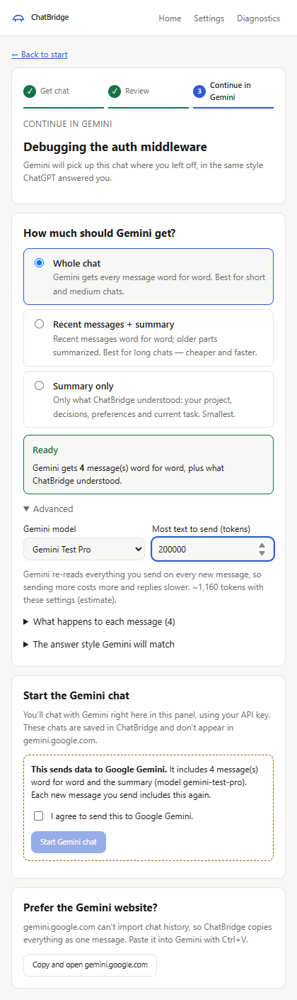
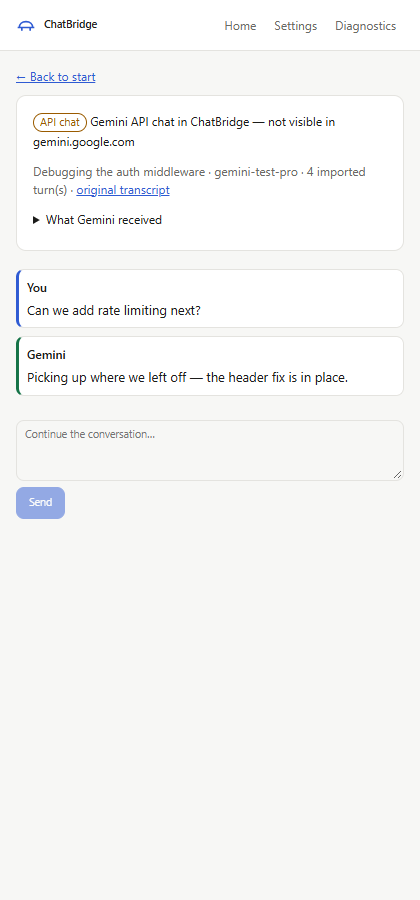

# ChatBridge

A Chrome extension (Manifest V3) that moves an AI conversation from **ChatGPT** to **Google Gemini**
with its history and working context intact — decisions, constraints, preferences, open issues — so
you can keep going without re-explaining everything.

Local-first: transcripts and analysis stay in your browser. Nothing is sent anywhere until you tick a
consent box that says exactly what will be sent, and to whom.



## What it does

1. **Extract** the conversation — three methods, with explicit fallback:

   | Method                | When                                                                                                                      | Completeness it can claim                                                                                |
   | --------------------- | ------------------------------------------------------------------------------------------------------------------------- | -------------------------------------------------------------------------------------------------------- |
   | **Page (DOM)**        | The normal path: reads the open ChatGPT tab, optionally scrolling through it first                                        | `unknown` at best — the page can't prove everything loaded, and shows only one branch of edited messages |
   | **Export file**       | The reliable fallback: your official ChatGPT data export (`.zip` or `conversations.json`)                                 | `complete` for the selected branch; other branches are counted, custom instructions captured             |
   | **Internal endpoint** | Advanced, **unofficial, off by default**: asks chatgpt.com for the conversation like the web app does, using your session | Same as the export, but current. May stop working at any time; ChatBridge never depends on it            |

2. **Analyze** — a local, rule-based pass runs automatically: instructions, preferences, constraints,
   decisions you accepted, tech stack, bugs and whether they were fixed, files, the current task. An
   optional Gemini pass adds semantic items and a summary. Every item must cite a real message with a
   verbatim quote, or it is discarded. Assistant suggestions are never treated as your decisions.
3. **Plan** — choose a mode, model and budget, and see what happens to every single message:
   - **Full history** — every message as real chat turns. Never truncated: if it doesn't fit, it won't start.
   - **Smart** — the context document plus only the messages you pin.
   - **Hybrid** — context + recent messages + messages that back key decisions; older parts summarized.
4. **Continue** — in a **Gemini API chat inside the side panel** (with your API key), or copy a
   paste-ready package into gemini.google.com. Either way Gemini is told to **answer in the same
   manner as ChatGPT did**: same language (including Hinglish), length, formatting and tone, measured
   from ChatGPT's replies, with up to 3 example replies. Your explicit instructions still take priority.

> **Important:** gemini.google.com has no way to import chat history. An API chat lives in ChatBridge
> and does **not** appear in your Gemini web history. The UI labels this everywhere.

## Status

| Phase                                                           | State                                                                                              |
| --------------------------------------------------------------- | -------------------------------------------------------------------------------------------------- |
| 0 · Architecture                                                | Done — [docs/ARCHITECTURE.md](docs/ARCHITECTURE.md)                                                |
| 1 · Extension foundation                                        | Done                                                                                               |
| 2 · Extraction (DOM, export, endpoint), schema, local storage   | Done                                                                                               |
| 3 · Context intelligence (rules + Gemini, evidence-checked)     | Done                                                                                               |
| 4 · Gemini integration (modes, mapping, streaming chat)         | Done                                                                                               |
| 5 · Budgets, summaries, checkpoints/resume, deletion, hardening | Done                                                                                               |
| 6 · Docs, screenshots                                           | Done                                                                                               |
| **ChatGPT page selectors validated against a real account**     | **Partly** — rebuilt from a real Diagnostics report (Nov 2026); extraction not yet confirmed there |

Everything is tested against fixtures and a stand-in for the Gemini API (see [Testing](#testing)).
Two things have **not** been verified: the ChatGPT page structure on a real logged-in account, and
calls to the real Gemini API with a real key.

## Install

Requirements: Chrome 116+, Node.js 20+.

```bash
npm install
npm run build
```

In Chrome: `chrome://extensions` → enable **Developer mode** → **Load unpacked** → select `dist/`. Pin
ChatBridge and click its icon to open the side panel. After rebuilding, press the reload icon on the
ChatBridge card; open ChatGPT tabs reconnect automatically.

## Gemini API setup

1. Create a key at [aistudio.google.com](https://aistudio.google.com) → **Get API key**.
2. ChatBridge → **Settings** → paste the key → **Save**. ChatBridge loads the models your key can use,
   with their context limits. Choose a default.
3. Choose where the key lives:
   - **Until the browser closes** (default) — memory only (`chrome.storage.session`).
   - **Remember on this device** — `chrome.storage.local`, which is **unencrypted** in your Chrome
     profile. Web pages can't read it; anyone or anything with access to your profile can. ChatBridge
     doesn't pretend to encrypt it, because a key stored next to its ciphertext protects nothing.

The key is sent only to `generativelanguage.googleapis.com` and is never logged. Usage is billed to
your key. Note that **every new message resends the whole migrated history**, so a larger budget costs
more per turn.

## First run

1. Open a long ChatGPT conversation, open ChatBridge, and run **Diagnostics → Page structure**, with
   and without the scroll test. The report contains structure only — no message text, titles or
   tokens. Sharing it lets the selectors be confirmed or fixed (they all live in
   `src/content/chatgpt/selectors.ts`).
2. **Home → Analyze conversation.** Compare the transcript with what you see in ChatGPT.
3. For a complete copy, import your export (ChatGPT → Settings → Data controls → Export data).
4. **Prepare migration** → pick a mode → tick consent → **Start migration** → send a message.

## Using it

- **Home** — the detected conversation, extraction, export import, and your local library of
  transcripts and continued chats.
- **Transcript** — extraction method, completeness and why, warnings, excluded items with reasons, the
  context profile (each item shows its status and links to its evidence), and the full transcript.
- **Migrate** — mode, model, budget, pins, a per-message preview (`included` / `summarized` /
  `excluded` + reason), token estimates, and both destinations.
- **Chat** — the continued conversation with streaming and stop/retry. **What Gemini received** shows
  the exact system instruction.
- **Settings** — API key, defaults, the unofficial endpoint toggle, and **Delete all ChatBridge data**.

| Migration preview                          | Continued chat                       |
| ------------------------------------------ | ------------------------------------ |
|  |  |

## Privacy & security

- Processing is local by default. IndexedDB (extension origin) holds transcripts, analyses, plans and chats.
- Consent gates precede anything that leaves the machine: Gemini analysis, migration, the unofficial endpoint.
- Original transcripts are append-only versions, kept separate from derived context. Plans that were
  sent are kept as an audit trail.
- Conversation content is rendered as text only — never as HTML — and extracted code is never run.
- The content script accepts messages only from ChatBridge itself, validates every payload, and never
  reads the ChatGPT sidebar (your other conversations).
- The unofficial endpoint uses only your existing session, adds no headers, never retries a refusal,
  and keeps the access token inside the ChatGPT page.
- Imported history is framed to Gemini as data, not instructions. This reduces, but cannot eliminate,
  prompt-injection risk from instructions buried in old messages or tool output.
- Minimal permissions: `sidePanel`, `scripting`, `storage`; hosts: ChatGPT and the Gemini API only.

## Known limitations

- **ChatGPT page selectors** match the layout in one real account's Diagnostics report (Nov 2026). If
  ChatGPT changes its layout again, page extraction reports "no messages found"; the export always works.
- ChatGPT keeps only a few turns of a long chat on the page at a time (5 in that report), so page
  extraction must scroll. For a whole chat in one step, use the internal endpoint or the export.
- Page extraction captures only the branch on screen; the export captures all of them.
- Images and files are not transferred (ChatGPT file pointers can't be fetched); they appear as
  labelled placeholders. The other assistant's internal reasoning and ChatGPT memory are not transferred.
- Token counts are conservative local estimates, not Gemini's tokenizer.
- Exports over ~1 GB are refused; parsing happens in the panel's memory.
- The gemini.google.com package is one long message, and the website may reject very long ones (use Smart).

## Troubleshooting

| Symptom                                        | Fix                                                                                                   |
| ---------------------------------------------- | ----------------------------------------------------------------------------------------------------- |
| "Open a ChatGPT conversation" on a ChatGPT tab | Click into the ChatGPT tab once; reload it if it was open before installing.                          |
| "No messages were found on the page"           | Wait for the chat to load. If it persists, ChatGPT's layout changed: use the export, run Diagnostics. |
| "Gemini rejected the API key"                  | Re-paste the key in Settings; check it is enabled for the Generative Language API.                    |
| "rate-limiting requests"                       | ChatBridge already retried with backoff; wait, then press **Retry last message**.                     |
| Plan shows "does not fit"                      | Raise the budget, switch to Smart/Hybrid, or unpin messages. Full history never truncates.            |
| A reply shows "Interrupted"                    | The panel was closed mid-reply. Press **Retry last message**.                                         |
| Gemini analysis stopped halfway                | Run it again; finished parts are checkpointed and reused.                                             |

## Development

| Command                                 | What it does                                                     |
| --------------------------------------- | ---------------------------------------------------------------- |
| `npm run build`                         | Typecheck, build pages + service worker, then the content script |
| `npm run watch:pages` / `watch:content` | Rebuild on change (two terminals)                                |
| `npm test`                              | Unit tests (Vitest + jsdom)                                      |
| `npm run test:e2e`                      | Build, load `dist/` into Chromium, run Playwright                |
| `npm run lint` / `typecheck` / `format` | ESLint, `tsc --noEmit`, Prettier                                 |

Before the first e2e run: `npx playwright install chromium`.

### Testing

- **Unit (139 tests):**
  - Extraction: DOM conversion; export trees with edits, regenerations, cycles, malformed nodes and duplicates.
  - Storage, against a fake IndexedDB.
  - Context: the rules, and the Gemini pass with a fake model (unverifiable items dropped, assistant-only
    claims downgraded, checkpoint resume).
  - Migration: the planner and the Gemini history mapper.
  - The Gemini client through the real SDK, against recorded-style HTTP responses (errors, retries, streaming).
- **End-to-end (9 Playwright tests, real Chromium, built extension):** fixture pages are served _as_
  `chatgpt.com`, and a stand-in serves the Gemini API's paths and wire format. Covered:
  - Page extraction → analysis → key setup → plan → consent → migration → streamed reply → reopen.
  - Export import, then deleting all data.
  - The unofficial endpoint, gated by its setting and by consent.
  - Diagnostics that leak nothing.

### Layout

```
src/background/          MV3 service worker (stateless; persists extracted transcripts)
src/content/chatgpt/     content script: selectors, DOM extractor, endpoint, diagnostics
src/core/                platform-free logic: conversation schema, export parser, context engine,
                         token estimates, migration planner and sessions
src/providers/gemini/    Gemini client, history mapper, system instruction, session runner
src/storage/             IndexedDB stores and settings
src/sidepanel/           React UI
tests/                   unit, integration (Playwright), synthetic fixtures (no real data)
```

Adding another destination (e.g. Claude) means a new `src/providers/<name>/` with a mapper and a
session runner. The core and the UI flow stay the same.
